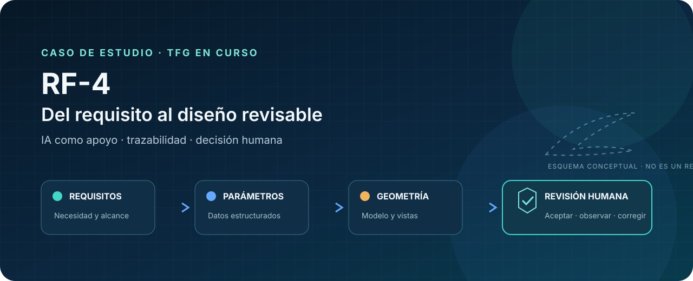
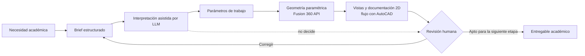
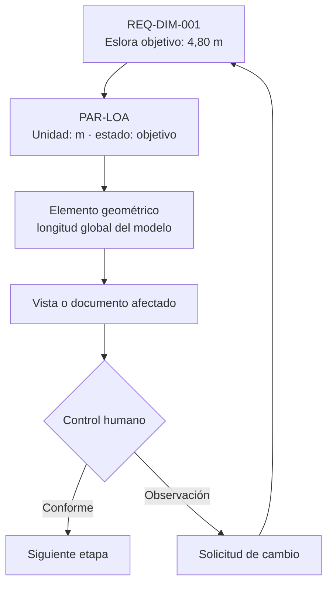

# RF-4 · del requisito al diseño naval revisable

> Caso de estudio académico sobre cómo usar IA como apoyo para traducir requisitos de diseño naval en parámetros, geometría y documentación trazables, manteniendo la decisión técnica bajo revisión humana.

**TFG en curso** · **Diseño asistido por IA** · **Product thinking** · **Human in the loop**

## En 30 segundos

| Reto | Enfoque | Mi contribución | Estado verificable |
|---|---|---|---|
| Evitar que un requisito se pierda al pasar del brief al modelo y al plano. | Un flujo con entradas estructuradas, asistencia de un LLM, modelado paramétrico y puertas de revisión. | Conceptualización, alcance, requisitos, arquitectura funcional, criterios de aceptación y documentación del proceso. | TFG en curso. Este repositorio publica el caso de estudio y su trazabilidad; no publica scripts, modelos 3D ni planos. |

El valor del proyecto no es «pedirle un barco a una IA». Es **convertir una intención en decisiones auditables**: qué dato entró, qué parámetro produjo, qué geometría afecta y quién debe aprobarla antes de avanzar.

[Visión y alcance](docs/01-vision-y-alcance.md) · [Arquitectura](docs/02-arquitectura-del-flujo.md) · [Trazabilidad](docs/03-trazabilidad-de-requisitos.md) · [Revisión humana](docs/04-decisiones-y-revision-humana.md) · [Límites](docs/05-riesgos-validacion-y-limites.md) · [Roadmap](docs/06-roadmap-academico.md) · [Evidencia](docs/07-mapa-de-evidencia.md)

## La decisión de producto

La IA se sitúa como **capa de interpretación y apoyo**, no como autoridad de ingeniería. Toda salida relevante debe conservar su procedencia y atravesar una revisión humana antes de alimentar la siguiente etapa.

La arquitectura completa y sus puntos de control están en [Arquitectura del flujo](docs/02-arquitectura-del-flujo.md).

## Parámetros de trabajo

Son **objetivos de diseño del TFG**, no resultados medidos ni prestaciones demostradas.

| Parámetro | Valor de trabajo | Naturaleza |
|---|---:|---|
| Eslora total | 4,80 m | Objetivo de diseño |
| Manga total | 2,00 m | Objetivo de diseño |
| Calado | 0,35 m | Objetivo de diseño |
| Desplazamiento estimado | 180 kg | Estimación de trabajo |
| Velocidad máxima | 5 kn | Objetivo |
| Velocidad de crucero | 3 kn | Objetivo |
| Autonomía a crucero | 1,9 h | Objetivo |

El planteamiento contempla GNSS, cámara, unidad inercial, detección de obstáculos y recepción AIS como **categorías funcionales**. No presenta modelos comerciales como selección final.

## Qué demuestra mi trabajo

- Traducir una necesidad ambigua a un alcance comprobable.
- Diseñar la cadena de decisiones entre requisitos, parámetros, geometría y documentación.
- Separar lo que puede asistir un modelo de lenguaje de lo que exige juicio humano.
- Definir criterios de aceptación, estados y bucles de corrección.
- Comunicar un sistema técnico complejo sin ocultar incertidumbres ni límites.

Este es el punto de unión entre **producto, dominio e implementación técnica**: convertir el problema en un sistema de trabajo que otros puedan revisar, cuestionar y ejecutar.

## Un ejemplo de trazabilidad

La matriz pública está en [Trazabilidad de requisitos](docs/03-trazabilidad-de-requisitos.md). El archivo [design-brief.example.yaml](examples/design-brief.example.yaml) muestra una entrada ilustrativa legible por personas y sistemas.

## Límites explícitos

Este repositorio **no afirma** que el vehículo esté construido, probado o validado profesionalmente. Tampoco acredita fabricación, certificación, conformidad normativa, aprobación por una sociedad de clasificación ni prestaciones reales.

La compilación de un script, la generación de una geometría o la exportación de un plano no validan seguridad, estabilidad, estructura, navegación autónoma ni cumplimiento reglamentario. Consulta [Riesgos, validación y límites](docs/05-riesgos-validacion-y-limites.md).

## Cómo recorrer el caso

1. Empieza por [Visión y alcance](docs/01-vision-y-alcance.md) para entender el problema y mi rol.
2. Recorre la [Arquitectura](docs/02-arquitectura-del-flujo.md) y la [Trazabilidad](docs/03-trazabilidad-de-requisitos.md).
3. Revisa los controles en [Decisiones y revisión humana](docs/04-decisiones-y-revision-humana.md).
4. Contrasta cada afirmación en el [Mapa de evidencia pública](docs/07-mapa-de-evidencia.md).
5. Examina el [brief ilustrativo](examples/design-brief.example.yaml) y la [lista de aceptación](examples/review-checklist.md).

## Estado del repositorio

| Publicado aquí | En desarrollo / no público | No demostrado |
|---|---|---|
| Planteamiento, arquitectura funcional, parámetros objetivo, trazabilidad, controles, roadmap y límites. | Scripts, modelos 3D, planos, iteraciones y resultados académicos sujetos a revisión. | Construcción, pruebas de mar, validación profesional, certificación y prestaciones medidas. |

Trabajo Final de Grado en desarrollo en la Facultat de Nàutica de Barcelona, Universitat Politècnica de Catalunya. Este es un proyecto académico del autor; no se presenta como herramienta oficial de la universidad ni implica patrocinio de las marcas citadas.

**Autor:** Robert Garabán
