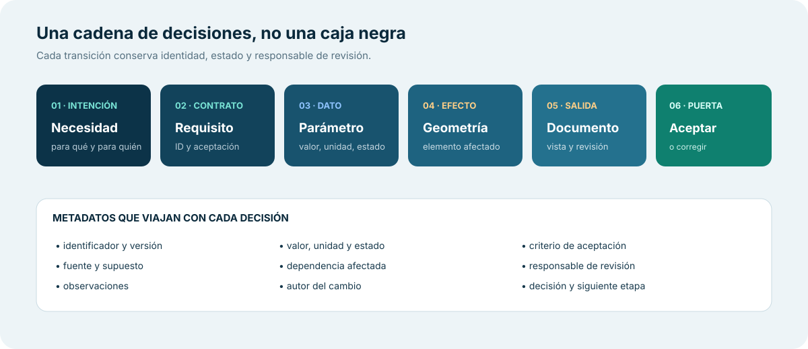
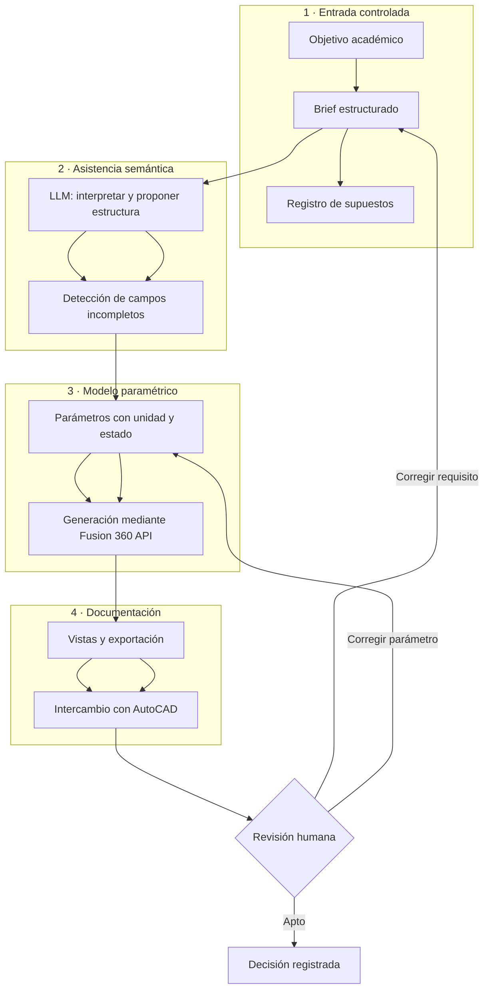
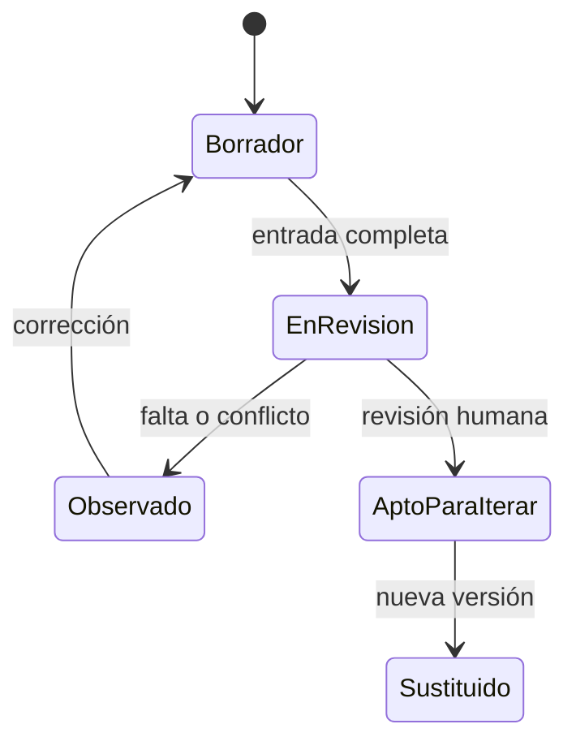

# Arquitectura del flujo

[← Visión y alcance](01-vision-y-alcance.md) · [Volver al caso](../README.md) · [Siguiente: trazabilidad →](03-trazabilidad-de-requisitos.md)

## Contratos entre etapas

| Transición | Salida esperada | Puerta de control |
|---|---|---|
| Necesidad → brief | requisitos y supuestos visibles | ¿hay ambigüedades críticas? |
| Brief → interpretación | propuesta estructurada, nunca aprobación automática | ¿conserva la intención? |
| Interpretación → parámetros | valores tipados con estado | ¿valor, unidad y condición son coherentes? |
| Parámetros → geometría | elementos paramétricos identificables | ¿corresponden a la entrada? |
| Geometría → documento | vistas o planos de revisión | ¿la salida es legible y trazable? |
| Documento → siguiente etapa | decisión registrada | ¿una persona autoriza avanzar? |

## Papel del LLM

Puede apoyar la extracción de requisitos, detectar campos ausentes y normalizar una estructura. No puede aprobar seguridad, estabilidad, estructura, navegabilidad, cumplimiento reglamentario ni aptitud para fabricación. Tampoco convierte una estimación en una medición.

«Apto para iterar» solo significa que el artefacto puede pasar a la siguiente etapa académica definida.
