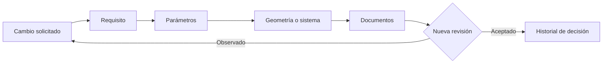

# Trazabilidad de requisitos

[← Arquitectura](02-arquitectura-del-flujo.md) · [Volver al caso](../README.md) · [Siguiente: revisión humana →](04-decisiones-y-revision-humana.md)

Cada requisito necesita un identificador estable y debe declarar qué parámetro, elemento geométrico y documento afecta. Una modificación no se propaga en silencio: abre una nueva revisión.

## Matriz ilustrativa del caso público

| Requisito | Parámetro asociado | Naturaleza | Elemento afectado | Evidencia prevista |
|---|---|---|---|---|
| REQ-DIM-001 · eslora objetivo | `length_overall_m = 4.80` | objetivo | longitud global | revisión dimensional |
| REQ-DIM-002 · manga objetivo | `beam_m = 2.00` | objetivo | ancho global | revisión dimensional |
| REQ-DIM-003 · calado de trabajo | `draft_m = 0.35` | objetivo | referencia del ejercicio | revisión del parámetro y su uso |
| REQ-MAS-001 · desplazamiento estimado | `displacement_estimate_kg = 180` | estimación | propiedades del estudio | supuesto revisado |
| REQ-OPS-001 · velocidad máxima | `max_speed_target_kn = 5` | objetivo | concepto operativo | método por definir |
| REQ-OPS-002 · autonomía | `endurance_target_h = 1.9` | objetivo | balance de misión | método por definir |
| REQ-PER-001 · percepción | `perception.categories[]` | alcance funcional | arquitectura conceptual | cobertura revisada |

## Metadatos mínimos

ID y versión; fuente; valor, unidad y naturaleza; supuestos; dependencias; criterio y responsable de revisión; decisión y observación.

El [ejemplo YAML](../examples/design-brief.example.yaml) evita que un valor pierda su unidad o parezca medido cuando solo es un objetivo. No es ejecutable ni demuestra un pipeline operativo.
