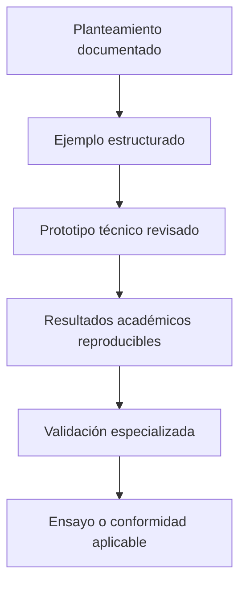

# Riesgos, validación y límites

[← Revisión humana](04-decisiones-y-revision-humana.md) · [Volver al caso](../README.md) · [Siguiente: roadmap →](06-roadmap-academico.md)

| Riesgo | Control de proceso | Límite del control |
|---|---|---|
| Interpretación incorrecta del LLM | comparar con el requisito y marcar supuestos | no prueba corrección técnica |
| Unidad o escala equivocada | esquema tipado y revisión dimensional | no valida el diseño naval |
| Propagación silenciosa | matriz de dependencias y nueva revisión | exige mantener la trazabilidad |
| Falsa precisión | estados explícitos: objetivo/estimación | no crea mediciones inexistentes |
| Automatización sin autoridad | puertas humanas y decisión registrada | depende de la competencia del revisor |
| Exposición de información | publicación mínima y mapa de evidencia | no sustituye una revisión de seguridad completa |

## Escalera de evidencia

Este repositorio aporta los dos primeros niveles. Los niveles superiores requieren artefactos, métodos y revisiones adicionales.

## Afirmaciones que se excluyen

- Vehículo construido o probado.
- Prestaciones medidas o diseño listo para fabricar.
- Validación estructural, hidrostática, de estabilidad o navegación autónoma.
- Certificación, homologación o aprobación de una sociedad de clasificación.
- Uso oficial por la universidad.

Las herramientas citadas describen el entorno estudiado; no implican patrocinio ni colaboración institucional.
