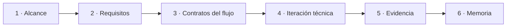

# Roadmap académico

[← Riesgos y límites](05-riesgos-validacion-y-limites.md) · [Volver al caso](../README.md) · [Siguiente: evidencia →](07-mapa-de-evidencia.md)

El roadmap expresa **trabajo previsto**, no hitos completados. Prioriza trazabilidad y revisión antes que automatización.

| Etapa | Entregable esperado | Criterio antes de avanzar |
|---|---|---|
| 1 · Alcance | problema, exclusiones y actores | ambigüedades críticas identificadas |
| 2 · Requisitos | brief versionado y parámetros tipados | unidades, fuentes y estados completos |
| 3 · Flujo | contratos entre etapas y estados | puertas de revisión definidas |
| 4 · Prototipo | iteración técnica no pública | correspondencia entrada/salida revisada |
| 5 · Evidencia | trazas, decisiones y resultados académicos | afirmaciones limitadas a la evidencia |
| 6 · Memoria | caso reproducible y discusión crítica | revisión académica correspondiente |

El alcance, los parámetros y las herramientas pueden evolucionar. Cada cambio relevante debe actualizar el brief, su mapa de impacto y la declaración pública.
